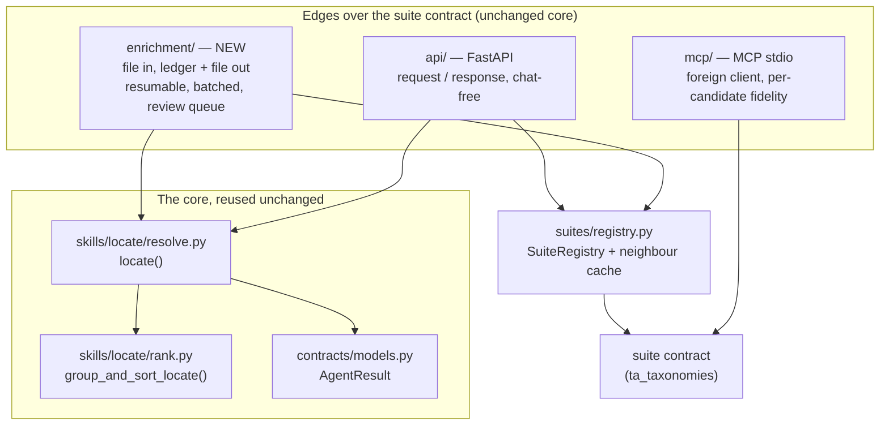
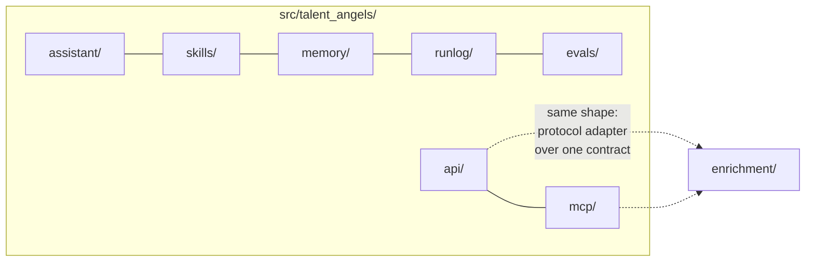
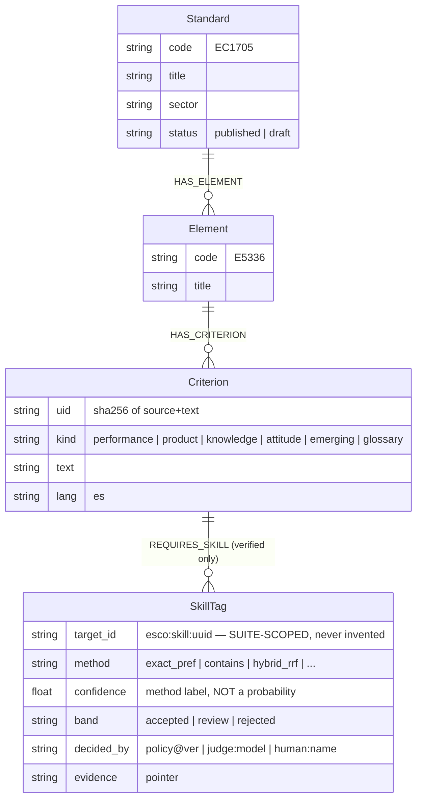
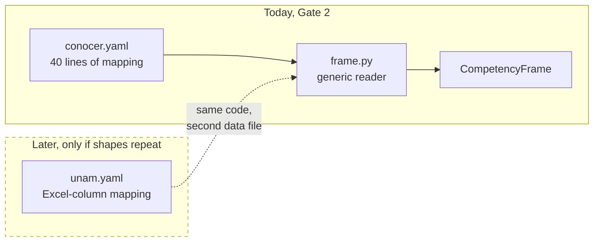
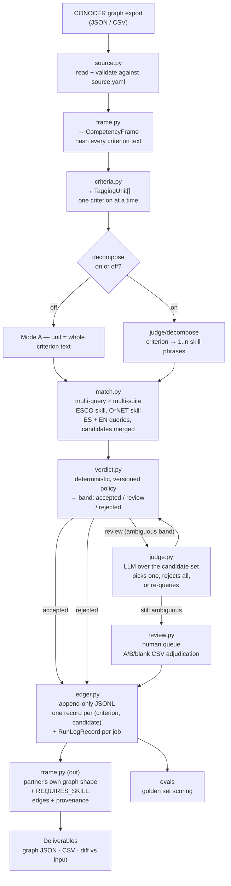
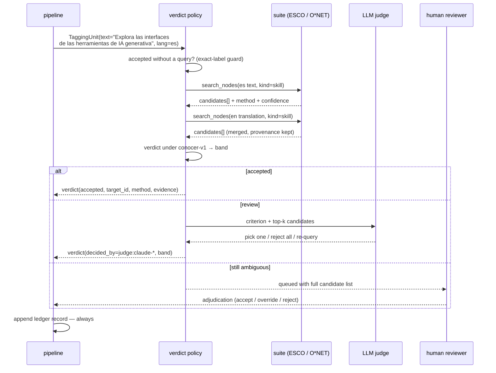
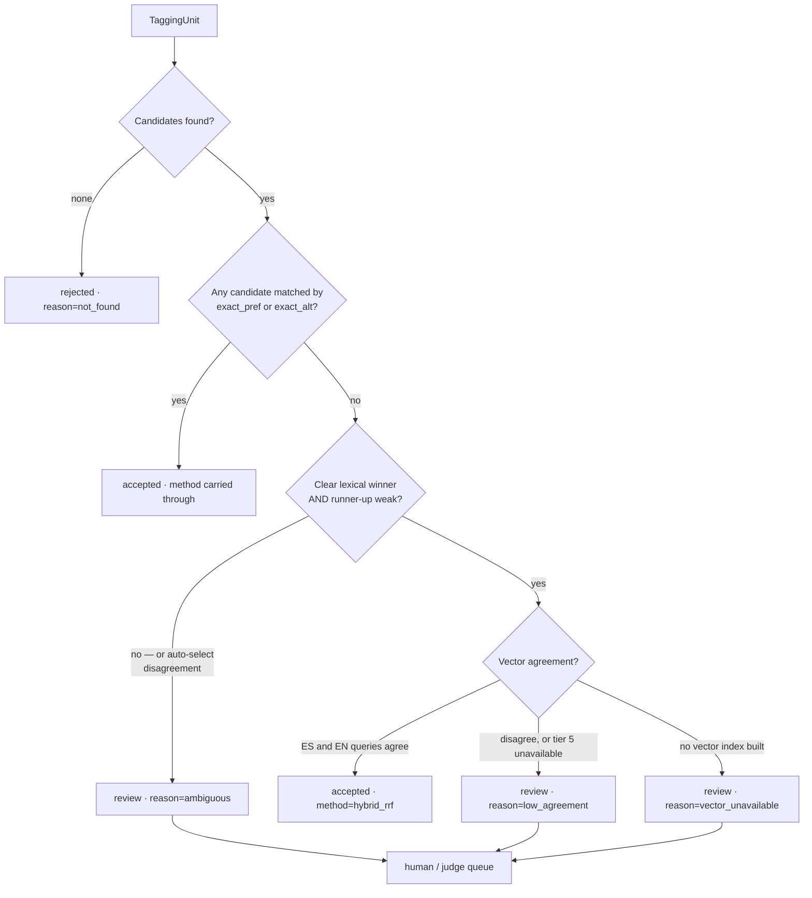
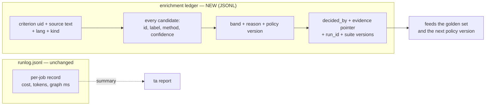
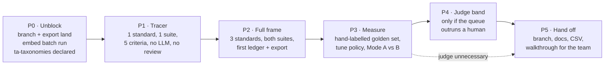

# Gate 2 — The CONOCER B2B Pilot: research findings and design

> **Status:** design proposal, open for discussion. Not an ADR — the decisions
> inside it are candidates, and the ones that bind go through ADR-0008.
> **Scope:** the four Gate 2 checklist items in `SPRINT7_PILOTS_PROPOSAL.md`.
> **Date:** 2026-09-29. **Author:** Aman Sarraf, with a codebase + literature review.
>
> **Read alongside [`SPRINT7-B2B-PLAN.md`](SPRINT7-B2B-PLAN.md)** (2026-09-30),
> which re-verifies this design against the live graph and **supersedes this
> document's sequencing**. The research below still stands; the priorities do
> not — in particular, the critical path runs through loading the full ESCO
> graph, which this document predates. See also
> [`HANDOVER-2026-09-30.md`](HANDOVER-2026-09-30.md).
>
> **Note on links:** `SPRINT7_PILOTS_PROPOSAL.md` lives in `data/`, which is
> gitignored, so it is not in the repository. Ask in the workspace, or read
> `SPRINT7-B2B-PLAN.md`, which supersedes it for planning. References to
> "ADR-0006" below mean `TA-memory/decisions/0006-taxonomy-data-sources.md` —
> a different repo, hence not a relative link.
>
> What this document is for: Gate 2 is the first time Talent Angels touches
> somebody else's data and hands back a business deliverable. That is a
> different kind of risk from anything in Sprints 1–6, so the design below is
> organised around one question — *what would make this wrong, and how would we
> find out before CONOCER does?*

---

## Part 1 — Findings

### 1.1 What already exists (and is genuinely reusable)

The good news is that Gate 2 needs **no new graph access, no new search, and no
new agent**. Everything the pilot does at the graph layer is already a pure,
LLM-free function.

| Reusable today | Where | Why it fits |
| --- | --- | --- |
| `locate(suite, name, text, kind=)` | `skills/locate/resolve.py:85` | Pure function, one `search_nodes` call, no LLM, no I/O, no session. The batch primitive. |
| `group_and_sort_locate()` | `skills/locate/rank.py:82` | Deterministic rerank + auto-select. Mandatory after every `locate()` per `ARCHITECTURE.md:186`. |
| `AgentResult` typed contract | `contracts/models.py:50` | Evidence-as-pointer, typed warnings, suite-scoped IDs. Carries into the business deliverable unchanged. |
| `SuiteRegistry` / `default_suite_registry()` | `suites/registry.py:105` | Lazy, context-managed, neighbor cache already wired. Reuse the neighbour cache for the ISCO group hops. |
| `MeasuredSuite` | `suites/measured.py:14` | Transparent per-tool timing wrapper. Gives us graph cost per criterion for free. |
| `CachedSuite` (SQLite) | `memory/cache.py` | Absorbs repeat `get_neighbors`. Does **not** cache `search_nodes` — by design. |
| `evals/locate.py` `LocateMetrics` | `evals/locate.py:10` | `hit_at_1_accuracy` + `candidate_recall`. Already the right two numbers. |
| `evals/quality.py` `QualityCase` / `score_case` | `evals/quality.py:54,248` | Typed cases, offline scoring, no LLM needed. The golden-set harness already exists. |
| `evals/rerank.py` + `tests/evals/golden_rerank.json` | `evals/rerank.py:26` | Precedent for a hand-labelled ambiguity adjudication set. |
| `RunLogRecord` + `append_record()` | `runlog/writer.py` | Append-only JSONL, cost + tool telemetry. |
| `LLM_PROVIDER=none` | `llm/factory.py:23` | `StubLLMClient`, zero tokens, a supported *production* config. The deterministic half of this pipeline is fully runnable with no model at all. |
| `tests/fakes/suite.py` `FakeSuite` / `fake_registry` | `tests/fakes/` | The whole pipeline is testable without Neo4j. |
| The MCP edge | `mcp/server.py` | **Precedent**: the first non-chat programmatic consumer of the suite contract, with a clean error-is-a-return discipline. |

### 1.2 What does not exist at all

Exhaustive sweep of `src/` (92 files) for `batch|bulk|worker|concurrent|enrich|ingest|upsert|csv|parquet`:
**4 matches, all one TUI spinner thread.** So, from zero:

- No batch/pipeline/worker harness, no concurrency, no job loop.
- No third-party data adapter of any kind. `ta_taxonomies/crosswalks/` and
  `ta_taxonomies/ingestion/` are docstring-only `__init__.py` files — the
  architecture for this was specified in ADR-0006 and never built.
- No output sink other than append-only JSONL, and it is lossy (see 1.3.6).
- No resumability, no idempotency, no checkpointing.
- No CLI subcommand that reads a file.

**Conclusion:** Gate 2 is a *new edge* over the existing suite contract, not a
new capability and not a change to Locate. The code that already exists is the
right code; what is missing is the driver around it.

### 1.3 Seven landmines in the existing code that shape the design

These are verified, not hypothetical. Each one changes the design.

**1.3.1 — `Candidate.confidence` is a method label, not a probability.**
`ARCHITECTURE.md:163` and `esco/config.py:55` both say it: the number means
"how was this match made", not "how probable this is right". `exact_pref` → 0.95.
If a 0.95 goes into a national certification deliverable and CONOCER reads it
as "95% correct", we have published a lie with our name on it. **The B2B
deliverable needs its own verdict field, not the suite's confidence.**

**1.3.2 — `group_and_sort_locate()` can confidently auto-select on a lexical
coincidence.** When one candidate's `lexical_rank` tier beats the runner-up
(`rank.py:132`), it collapses to a single node at confidence `0.95`. For chat
this is right — the user wanted one answer. For a *mapping* it is a hazard: a
criterion that merely shares a word with a skill label would be tagged with
high declared confidence and no review. **The auto-select must be disabled, or
its output must be forced into the review band, on the enrichment path.**

**1.3.3 — Tier 5 is labelled `hybrid_rrf` but is vector-only.**
`esco/tools.py:491`: `bm25_rows = rows  # empty at this point`. The RRF fuses an
empty list with the vector list. So "hybrid search" in our search pipeline is a
*name*, not an implementation. Combined with the Gate 1 item that the embed
batch job has **never been run against real data**, the practical situation is:
**a semantic pipeline for Spanish competency text may currently be running on
keyword tiers only.** This is the single biggest functional risk in Gate 2 and
it is a Gate 1 dependency, not a Gate 2 one.

**1.3.4 — Language.** CONOCER is Spanish. The ESCO CSV we have loaded is
`csv_v1.2.1/*_en.csv`, and O*NET is English. `pref_label` matching across
languages can only fall through to `contains` (0.70) or `not_found`. This is
first-order, not a detail — see §2.5.

**1.3.5 — `locate()` folds away the match method.** `resolve.py:96` keeps only
`candidates[0].confidence` as one turn-level number; `method` is dropped
(`resolve.py:45` documents that the MCP edge is the only surface that preserves
it). For a reviewer deciding whether to accept a tag, *"matched by exact
preferred label"* and *"matched by substring"* are different facts, and the
number is identical-looking. **The pipeline needs `method` back.**

**1.3.6 — The run log cannot be the audit trail.** `ResultSummary`
(`runlog/models.py`) persists only `confidence`, `node_ids`, `node_labels`,
`warnings`. Not kinds, not evidence pointers, not per-candidate method, not
edges. A national certification body will ask "why does E5336 carry this skill?"
and the run log cannot answer. **The pipeline needs its own ledger.**

**1.3.7 — Reproducibility.** `ta-taxonomies` is **not** declared in
`TA-agents/pyproject.toml` (the dependency is commented out, pending publication
per ADR-0004). It is installed editable in the local venv only. A pilot branch
that other people clone will not have the suite library, and the suite library
is where the search implementation lives. **This must be fixed before the branch
is shared** — it is the "share the GitHub branch" checklist item, and it is
currently a hard blocker on it.

### 1.4 Two blockers that are not about code

1. **The CONOCER source files are not in the workspace.** I searched the whole
   TA-workspace tree for `neo4j_query_table_data*`, `Matriz*`, `EC1705`, `EC1691`,
   `*conocer*`: zero hits. The sprint doc is explicit that the files "stayed
   outside this repo". **Gate 2's first blocker is data access, not
   architecture.** Everything below is buildable, but nothing is *runnable*
   until the branch and the export land.
2. **The scarcest resource in the project is the domain expert.** Alejandro
   chairs one of CONOCER's standard-writing committees and is the only person who
   can hand-label a golden mapping set. Every phase below is sequenced so that
   his labelling time is spent in Phase 3, on a small set, once — and then the
   numbers justify scaling to the other ~1,600 standards.

---

## Part 2 — Research on the outside world

### 2.1 The closest prior art: the ESCO ↔ O*NET crosswalk

The European Commission built exactly this problem and published how they did it
([esco.ec.europa.eu](https://esco.ec.europa.eu/en/about-esco/data-science-and-esco/crosswalk-between-esco-and-onet)):

1. ML models propose matches by **semantic textual similarity** — occupation
   definitions embedded, cosine similarity, BERT fine-tuned with labour-market
   expert feedback.
2. **Top-10 candidates proposed per source item** (not top-1 — deliberately
   over-generate).
3. **Humans validate every proposed pair.** The ESCO team distributed them and
   judged each relationship.
4. Only then is the crosswalk published.

**The transferable lesson is the shape, not the model: machine proposes a
generous candidate set, humans dispose.** A pipeline that auto-commits its top-1
is not a cheaper version of this; it is a different and worse product.

### 2.2 The most comparable engineering result: ESCoE's Skills Extractor

The [ESCoE Skills Extractor Library](https://www.escoe.ac.uk/the-skills-extractor-library)
does free text → taxonomy for ESCO. Its published measured result, on ~200
hand-judged sampled skill entities:

- **6%** of extracted skill entities were inappropriate.
- Of the **94%** that were appropriate, **88%** were also appropriately mapped.
- ≈ **83% end-to-end precision.**

Critically, its pipeline is **two-stage**, not one:

```
raw text ──► [1. extract skill phrases] ──► [2. map each phrase to the
                                                semantically closest ESCO skill]
```

The second stage is the one we already have. **The first stage is the one we do
not have.** And ESCoE names the two failure modes that will also bite us:

- **Metaphor** — *"understand the bigger picture"* → ESCO *"interpreting
  technical documentation and diagrams"*. Semantically close, completely wrong.
- **Multi-skill sentences** — *"assist with the"* → ESCO *"providing general
  assistance to people"*. The span is not a skill; the matcher has nothing
  better to offer.

### 2.3 The realistic target number

[SkiLLMo (ACM SAC 2025)](https://dl.acm.org/doi/10.1145/3672608.3707960):
BERT segment filter → LLM extraction → vector-store match against ESCO, judged
by domain experts. **Precision 91% extraction · 80% standardization · 79%
combined.**

So the honest planning assumption for this pilot is **~80% precision on accepted
tags**, with the remaining 20% being either wrong tags or tags we should have
abstained on. That number is what makes the review queue mandatory rather than
optional.

### 2.4 How this kind of system is evaluated (and how we will get it wrong by accident)

Precision-at-1 is the wrong primary metric here, and using it would flatter us:

- [A practical framework for entity linking evaluation (PubMed 41680815)](https://pubmed.ncbi.nlm.nih.gov/41680815)
  shows accuracy alone "fails to capture the complexity of model behaviour", and
  argues for **hierarchical** error profiles: mapping a mention one level too
  specific is a different, more forgivable error than one level too general, and
  the two must not be averaged together.
- **LCA-F1** (least common ancestor F-score) gives partial credit for landing
  near the right place in a hierarchy.

This matters because **ESCO is a hierarchy**. Tagging *"write GenAI prompts"* with
ESCO *"use scripting programming"* is over-specific; tagging it with *"use digital
tools"* is over-general. Both are wrong, they are wrong in **opposite
directions**, and a flat hit@1 number cannot tell us which one we are doing more
of. **We will report the direction, not just the count.**

[OAEI 2025](https://ceur-ws.org/Vol-4144/om2025-oaei-paper0.pdf) makes the
complementary point: on curated tasks, precision-heavy matchers beat
recall-heavy ones, and LLM matchers (LogMapLLM, Agent-OM) reach F1 ~0.88–0.94 —
competitive with twenty-year-old classic systems. **Precision over recall is the
right trade for a certification standard: a wrong tag is worse than a missing
one.** Abstention is a first-class success, not a failure.

### 2.5 The real CONOCER structure (verified against primary sources)

The sprint doc's four-way split is right but incomplete. From CONOCER's own
published standards (`conocer.gob.mx/contenido/publicaciones_dof/*`, format
N-FO-02), a standard is:

```
Estándar de Competencia (EC-nnnn)
└─ Elemento 1..k        (code E-nnnn, e.g. E4431, E1842)
   ├─ CRITERIOS DE EVALUACIÓN
   │  ├─ DESEMPEÑOS     (performance — "la persona es competente cuando demuestra…")
   │  ├─ PRODUCTOS      (products  — "la persona es competente cuando obtiene…")
   │  └─ CONOCIMIENTOS   (knowledge — note: "en su caso", i.e. optional)
   ├─ Respuesta ante situaciones emergentes
   ├─ Actitudes / Hábitos / Valores
   └─ Glosario
```

Two consequences for the design:

- The shared structure needs **six** criterion kinds, not four. `emerging` and
  `glossary` are real parts of every standard and the sprint doc omits them.
  A glossary is especially valuable: it is a **dictionary written by the domain
  body about its own terms**, which is the highest-quality matching input in the
  whole document.
- **Knowledge criteria are optional** (`en su caso`). The pipeline must model
  absence, not just presence.

The university pilot's vocabulary is a different vocabulary over the same
national framework (CBM): *Competencia → Unidad de Competencia → Capacidad →
Saber / Saber-Hacer / Ser*. The unifying grammar is **verb + object +
condition** in both. That confirms the sprint doc's read — one shared design
serves both — with the caveat that the *text types* differ: CONOCER elements
carry **assessment criteria** (what you must demonstrate), university
capacidades are **capability statements** (what you can do). Different text,
same downstream matcher.

---

## Part 3 — The design

### 3.1 The one-sentence version

> Take a partner's graph, declare how their node types map onto one small
> canonical **competency frame**, run the existing deterministic Locate once per
> criterion, apply a **versioned verdict policy** that is allowed to say
> *"no match"*, escalate the ambiguous band to a model and then to a human, and
> hand back **their own graph shape with added, fully-attributed skill edges**.

Three properties make it defensible: nothing is invented, every tag is
attributable, and the absence of a tag is a valid output.

### 3.2 Where it lives

Gate 2 is a **new edge** over the existing suite contract — the same relationship
`api/` and `mcp/` have to Locate — with a different protocol: file in, ledger
and file out, resumable, batched.





**Answering the sprint doc's open question** — *does "one element at a time"
deserve its own capability name?*

**No. It is a new edge, not a new capability.** A capability earns a name when it
answers a question Locate cannot. What Gate 2 adds is a **driver** (a loop, a
ledger, resumability, a review queue) over Locate. "One criterion at a time" is
an *ingestion granularity* decision owned by the partner's data model, not by the
assistant — and the sprint doc's own reason for it (accuracy drops when you hand
the model a whole standard) is a finding about *model* context, not about Locate.
The honest name for the thing we are building is the edge, and it is
`enrichment/`. Revisit only if the judge's turn turns out to need graph tools
Locate does not expose — it should not, because it is a judgement over
candidates it was already handed.

### 3.3 The canonical shape: `CompetencyFrame`

A deliberately small superset that both pilots fit, and that CONOCER's actual
format defines precisely.



Two hard rules on this model:

1. **A `SkillTag` may only point at a suite-scoped ID that Locate actually
   returned.** This is `ARCHITECTURE.md` rule 6 (*no invented cross-taxonomy
   identity*) applied to a business deliverable. If nothing acceptable matched,
   the criterion gets **no edge** and a `rejected` record. *No tag is a valid,
   useful output.*
2. **`decided_by` is the honesty spine.** Every tag says who decided it. A model
   decision is labelled as model inference and is never presented as source data
   — the same rule the chat path already follows, enforced in the artifact
   rather than in a prompt.

### 3.4 The mapping is **data**, not code

The sprint doc recommends not building a universal adapter from two examples. I
agree with the recommendation and want to be precise about *why* it is safe: the
variation between partners is a **rel-type lookup table**, not control flow. So
the variability goes in a versioned config file, and the code is generic only in
the trivially-correct way.



**The deal:** we build the *mechanism* and ship exactly *one* mapping file. We
do not build a universal adapter, and we do not pretend the second mapping
exists. When the university Excel arrives, the question "is one shared design
really enough?" gets answered by writing a second data file — which is a much
cheaper experiment than a second adapter, and an honest one.

```yaml
# data/pilots/conocer/source.yaml
partner: conocer
version: 1
root_label: CONOCER
nodes:
  Standard:   { kind: Standard }
  Element:    { kind: Element,  via: HAS_ELEMENT }
  Criterion:  { kind: Criterion, via: HAS_CRITERION }
relations:
  CONTAINS_ELEMENT: HAS_ELEMENT
  REQUIRES_PERFORMANCE:  { via: HAS_CRITERION, as: performance }
  REQUIRES_PRODUCT:      { via: HAS_CRITERION, as: product }
  REQUIRES_KNOWLEDGE:   { via: HAS_CRITERION, as: knowledge }
  ATTITUDE:             { via: HAS_CRITERION, as: attitude }
  RESPONDS_TO_EMERGING: { via: HAS_CRITERION, as: emerging }
  DEFINES_TERM:         { via: HAS_CRITERION, as: glossary }
metadata_to_preserve: [code, sector, scian, sinco, status]
```

### 3.5 The pipeline



### 3.6 One criterion, end to end



### 3.7 The verdict policy — the heart of the design

This is a pure function. No LLM. No I/O. Fully testable offline, which is the
repo's own standard for a behavior that ships.



Three properties of this policy that matter more than the thresholds:

- **It can say no.** `rejected` is a first-class output. A pipeline that must
  always emit a tag cannot be evaluated, because there is no abstention to
  measure.
- **Auto-select disagreement is a signal, not a decision.** Where
  `group_and_sort_locate()` would collapse to a confident single pick
  (`rank.py:132`), the enrichment policy *refuses* to inherit that confidence
  and escalates instead. Reusing the rerank is right; inheriting its certainty is
  not.
- **Invisible infrastructure shows up in the verdict.** If the embed batch has
  never run, tier 5 returns nothing and the pipeline does not silently pretend
  the row was semantically confirmed — it routes the row to review with
  `reason=vector_unavailable`. The 1.3.3 landmine becomes a visible queue, not a
  quiet quality regression.

Thresholds live in one versioned file (`policy.py`, `conocer-v1`), named and
cited in every verdict — exactly how `PolicyRef` works for `score_paths`.

### 3.8 The ledger — the audit trail the run log cannot be

Landmine 1.3.6 said the run log is lossy. So the pipeline writes its own.



`RunLogRecord` is still written (one per job, aggregate `GraphStats`, via
`MeasuredSuite`), so cost and latency telemetry stays in one place and
`ta report` keeps working. But the **ledger** is what answers *"why does E5336
carry this skill?"* — and that is the question CONOCER will actually ask.

### 3.9 Resumability

Content-addressed on `sha256(source_id + criterion_text) + policy_version`.
A re-run skips decided criteria unless `--force`. Without this, a run that dies
at 400 of 800 criteria has burned its budget and produced nothing it can trust.

### 3.10 Evaluation — where the pilot is actually won or lost

The repo's rule: *new behavior ships with a test; new skills ship with golden
evals.* Gate 2's deliverable is a claim about quality, so it needs a quality
baseline built before scaling, not after.

| Metric | Why this one | Source |
| --- | --- | --- |
| **hit@1 on accepted rows** | did we tag correctly where we claimed to | reuse `evals/locate.py::LocateMetrics` |
| **abstention precision** | of the rows we rejected, how many *should* have been rejected | new — this is the metric the sprint has no name for |
| **error direction** (over- vs under-specific) | are we drifting to generic skills or hallucinating precise ones | new — L1–F1 / LCA-style, from §2.4 |
| **review-queue yield** | what fraction of the queue a human agrees with | new — measures our own triage |
| **Mode A vs Mode B** | does decompose-then-match actually beat whole-criterion matching | new — the headline falsifier |

Reuse `QualityCase` / `score_case` / `ObservedTurn`; do not invent a harness. All
of it runs offline against the fake suite, then live in `tests/integration/`.

**The headline number should be a comparison, not a score.** Gate 2 succeeds when
it can say *"decompose-then-match lifted accepted-row precision from X to Y at a
cost of N model calls"* — because that is a finding the team can act on, and a
single score is just a vibe with decimals.

### 3.11 Module shape

```
src/talent_angels/enrichment/
├── __init__.py     # public: EnrichmentJob, EnrichmentRun, run_enrichment
├── models.py       # SourceMapping, CompetencyFrame, Criterion, MappingVerdict,
│                   #   VerdictBand, SkillTag  (all Pydantic v2)
├── source.py       # load + validate a partner mapping (yaml/json)
├── frame.py        # source graph → frame → enriched export   ← only place rels are read
├── criteria.py     # frame → TaggingUnit[]  (one at a time, hashed)
├── match.py        # TaggingUnit → CandidateSet  (multi-query, multi-suite)
├── verdict.py      # CandidateSet + policy → Verdict   (pure, deterministic)
├── judge.py        # optional LLM band: decompose + re-rank  (labelled inference)
├── policy.py       # the versioned policies — `conocer-v1`
├── ledger.py       # append-only JSONL + RunLogRecord bridge
├── review.py       # the human queue: adjudication CSV in/out
├── pipeline.py     # the driver: loop, resume, concurrency, budget
└── cli.py          # `ta-enrich plan | run | review | export`
```

Dependencies point one way: `judge.py` knows nothing about `ledger.py`;
`verdict.py` imports no I/O. `frame.py` is the **only** module that reads a
partner's relationship types — which is what makes "one shared design" a
testable claim rather than a slogan.

### 3.12 Phasing



Each phase has a **kill criterion**, not just a deliverable:

- **P1 kills the design** if one criterion cannot reach an `accepted` verdict
  through Locate without an invented ID.
- **P3 kills Mode A** if decompose-then-match does not beat whole-criterion
  matching on accepted-row precision at an acceptable cost.
- **P4 is skipped entirely** if the review queue clears in under an hour — in
  which case the model was never the bottleneck and we should not have added it.
- **P5 does not scale to 1,600 standards** until precision is measured, not
  assumed.

### 3.13 Cost and latency

Rough sizing for the 3 standards in hand: ~3 elements each × ~8 criteria ≈
**70–80 criteria**. At 2 suites × 2 languages that is ~300 `search_nodes` calls —
negligible for Neo4j. Model calls: ~80 decompositions plus ~25 judge calls on
the ambiguous band. That is **pennies**.

**So cost is not a reason to skip the LLM — honesty is.** The decomposition step
is model *inference* and must be labelled as such in the ledger. If someone
proposes removing it for cost, that is the wrong argument and should be
rejected. If they propose removing it because its output is not attributable
enough for a certification body, that is the right argument.

### 3.14 What I might be wrong about

Recorded so the pilot can falsify the design rather than quietly absorb it:

- **If hit@1 on the golden set lands below ~0.6**, matching whole criteria to
  skill labels is the wrong unit of work, and the pipeline should move fully to
  extract-then-normalize. This is the single biggest design risk, and §2.2 says
  the prior art is unambiguous in favour of decomposition — we are running Mode A
  *against* the evidence in order to measure it.
- **If the Spanish/English gap proves unbridgeable by translation**, Gate 2 needs
  a TA-taxonomies change to load ESCO's Spanish labels alongside English. Bigger,
  but correct. Better decided from a measurement than assumed.
- **If CONOCER rejects the review queue** as too heavy for their committee
  chairs, the whole human-validation step needs a cheaper substitute and the
  precision target drops. This is a conversation to have in P0, not P5.
- **If `kind="skill"` behaviour on O*NET turns out to be poor** (O*NET's
  `Skill` kind covers only Content-Model `2.A`/`2.B`/`2.D`/`2.E`, a much
  narrower slice than ESCO's 13,485 concepts), then O*NET contributes little to
  skill tagging and the pilot is effectively ESCO-only. Cheap to measure in P2,
  and it would be better to know early.
- **If the second mapping file turns out to need code**, the "shared structure"
  claim from the sprint doc is wrong and the university pilot needs its own
  design. That is fine, and it is exactly what P6 (not Gate 2) is for.

---

## Part 4 — What I would do next

1. **Unblock the data.** Chase the branch and the export. Nothing here is
   runnable until they land — that is P0, and it is not a code task.
2. **Fix the two reproducibility gaps.** Declare `ta-taxonomies` in
   `pyproject.toml`; run the embed batch job for ESCO and O*NET. The second is
   already a Gate 1 checkbox, and Gate 2's quality ceiling depends on it.
3. **Decide the `method` question** (landmine 1.3.5). Preferred: one additive
   field on `AgentResult` — needs a code-owner review per `CODEOWNERS`, because
   `contracts/` is a protected path. Fallback that needs no review: a
   single-call adapter in `enrichment/` that reads `ToolResult.candidates`
   directly and feeds both the verdict and the ledger. I would take the fallback
   and leave the contract alone.
4. **Build P1 as a single tracer bullet** — one standard, one suite, five
   criteria, no LLM, no review. If the seam is not obvious in one sitting, the
   design above is wrong and cheap to find out.
5. **Have the "does it need a capability?" conversation now**, with the
   reasoning in §3.2, rather than leaving it open in the checklist.

---

## Appendix — verified claims and where they came from

| Claim | Source |
| --- | --- |
| `locate()` is a pure, LLM-free, single-call function | `skills/locate/resolve.py:85-107` |
| `group_and_sort_locate()` is mandatory after every `locate()` | `ARCHITECTURE.md:186` |
| Confidence is a declared method label, not a probability | `ARCHITECTURE.md:163-175`; `ta_taxonomies/suites/esco/config.py:55-62` |
| `locate()` drops the per-candidate `method` | `skills/locate/resolve.py:45-49, 96` |
| Auto-select raises confidence to 0.95/0.90 on a clear tier gap | `skills/locate/rank.py:128-161` |
| Grouping only applies to Occupations | `skills/locate/rank.py:59-61` |
| Tier 5's BM25 half is empty — it is vector-only | `ta_taxonomies/suites/esco/tools.py:491`; `onet/tools.py:443` |
| Tier 5 degrades to nothing without a built vector index | `ta_taxonomies/suites/esco/tools.py:643-671` |
| `kind="skill"` is a valid ESCO alias | `ta_taxonomies/suites/esco/config.py:42-53` |
| The run log persists no kinds, evidence, or per-candidate method | `runlog/models.py` → `ResultSummary` |
| No batch/pipeline/enrichment code exists in `src/` | exhaustive keyword sweep, 92 files, 4 hits in the TUI spinner |
| `ta-taxonomies` is not declared in `pyproject.toml` | commented out pending ADR-0004; editable local install only |
| The CONOCER source files are not in the workspace | full-workspace search for the export filenames, EC codes, and `conocer`: 0 hits |
| CONOCER standards have 6 criterion kinds incl. glossary and emerging situations | `conocer.gob.mx/contenido/publicaciones_dof/EC0581.pdf`, `.../2022/EC1448.pdf`, `.../2020/17.pdf` |
| ESCO↔O*NET used embeddings → top-10 → human validation | [esco.ec.europa.eu crosswalk](https://esco.ec.europa.eu/en/about-esco/data-science-and-esco/crosswalk-between-esco-and-onet) |
| Extract-then-map reaches ~83% end-to-end precision; metaphor and multi-skill are the failure modes | [ESCoE Skills Extractor](https://www.escoe.ac.uk/the-skills-extractor-library) |
| LLM-extract + vector-match ≈ 80% standardization precision | [SkiLLMo, ACM SAC 2025](https://dl.acm.org/doi/10.1145/3672608.3707960) |
| Hierarchical vocabularies need directional error analysis, not flat accuracy | [PubMed 41680815](https://pubmed.ncbi.nlm.nih.gov/41680815) |
| Precision > recall for curated alignment tasks; LLM matchers reach F1 ~0.88–0.94 | [OAEI 2025](https://ceur-ws.org/Vol-4144/om2025-oaei-paper0.pdf) |
